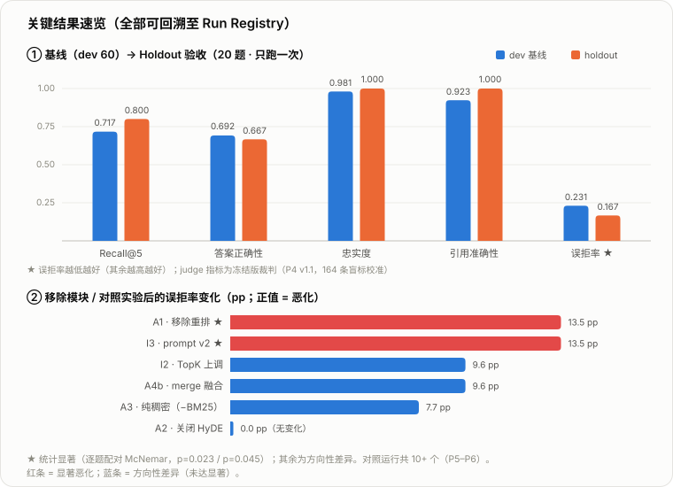
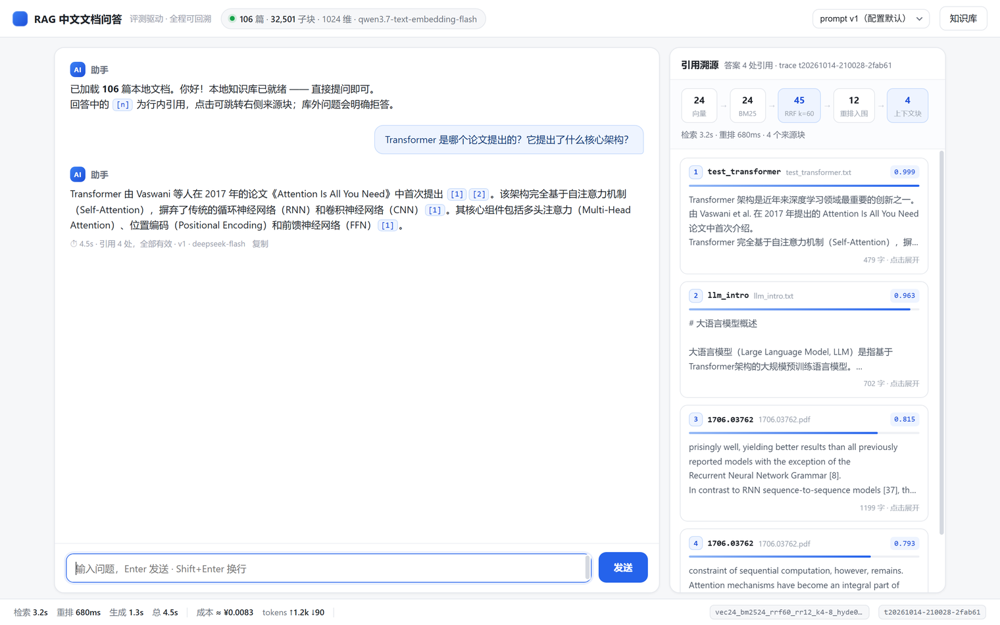
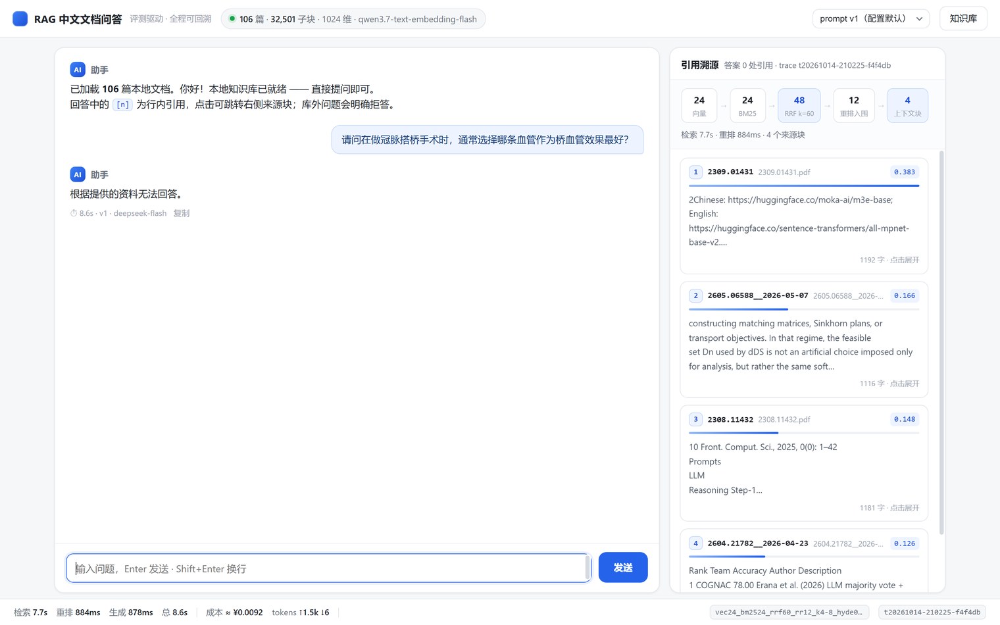
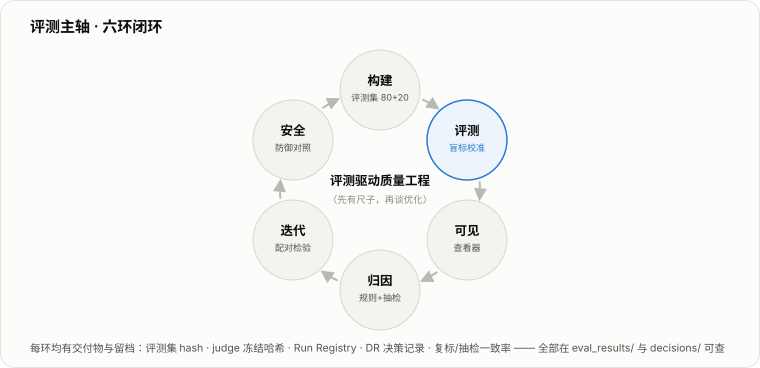
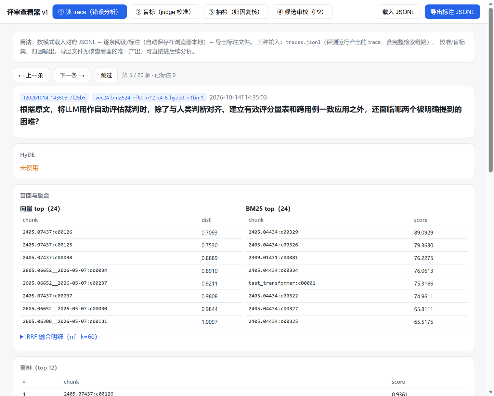
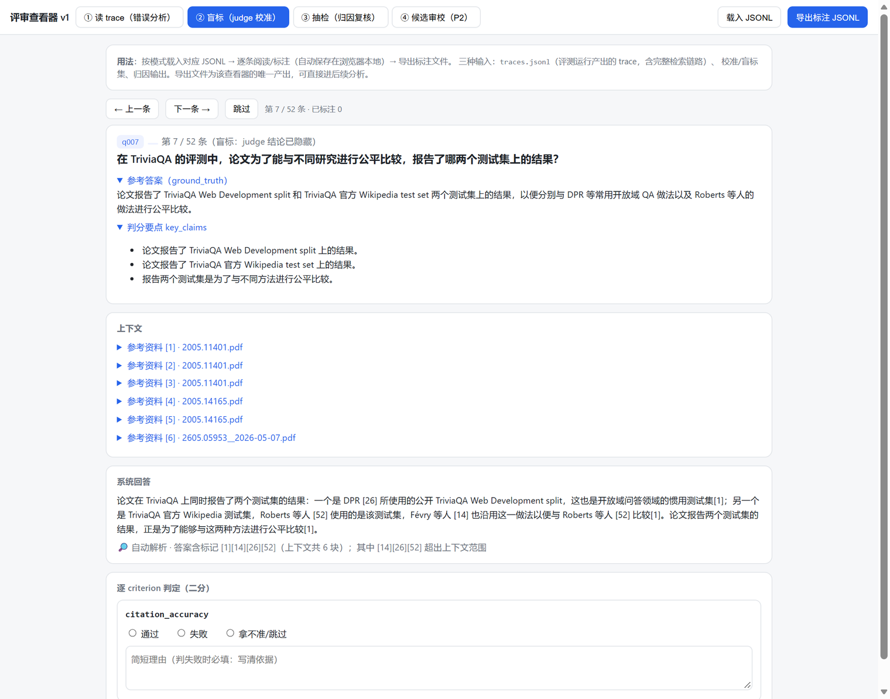
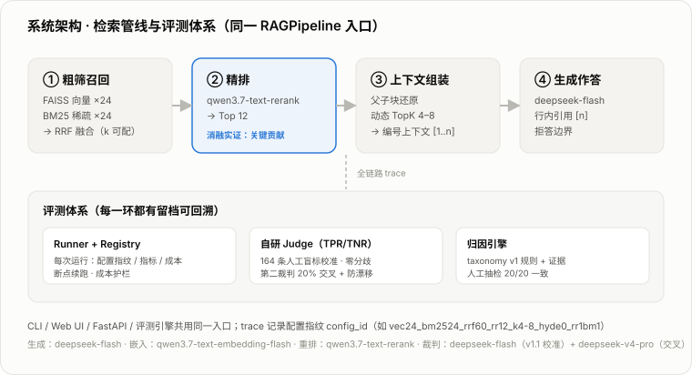

<h1 align="center">RAG-Chinese-QA</h1>
<p align="center">
  中文 RAG 文档问答系统 · 以评测为主轴的质量工程<br>
  混合检索（RRF）· 重排序 · 父块上下文 · 行内引用 [n] · 自研 Judge（人工盲标校准）· 归因闭环
</p>
<p align="center">
  
  
  
  
</p>
<p align="center">
  <a href="README.md">中文</a> | <a href="README.en.md">English</a>
</p>

中文 RAG 文档问答系统：在 106 篇论文/文档（32,501 子块）上做混合检索（FAISS + BM25 → RRF）与重排序，答案带 `[n]` 行内引用，库外问题明确拒答。

围绕它搭建了一套以评测为主轴的质量流程——构建 → 评测 → 可见 → 归因 → 迭代 → 安全。自研 Judge 经 164 条人工盲标校准后才用于主指标；消融、归因与负结果全部留档，每个数字可回溯到 Run Registry 与决策记录。

---

## 结果速览

<p align="center"></p>

| 指标（质量集 dev 60 / holdout 20） | 基线（R1） | Holdout 验收 |
|---|---|---|
| Recall@5（文档级） | 0.717 | 0.800 |
| 误拒率（质量题） | 0.231 | 0.167 |
| 答案正确性（judge） | 0.692 | 0.667 |
| 忠实度 / 引用准确性（judge） | 0.981 / 0.923 | 1.000 / 1.000 |
| 库外拒答率 | 1.000 | 1.000 |

- **Judge 校准**：164 条人工盲标 → 与校准后 judge 零分歧；第二裁判交叉 34/34；验收集异族锚点 10/10（[P4 校准报告](eval_results/calibration/reports/P4_calibration_report.md)）。
- **移除式消融**（配对 McNemar）：重排是唯一显著贡献（去掉后误拒 +13.5pp，p=0.023）；HyDE 净贡献≈0，省 45% 成本（默认关闭，DR-003）；RRF k 扫描为负结果；检索指标 run 间噪声地板 ±3–5pp。
- **Agentic 检索对照**（单轮工具选择 / 多查询合并，P9）：机制按设计生效——模型均发 2.7 次改写检索、合并后上下文跨来源；但对最终质量**无一项显著改善**：Recall@5 +1.7pp 落在噪声地板内、**MRR −13.1pp（排序退化）**、误拒 +5.8pp、多跳误拒 8→10，**目标缺口未闭合 → 不采纳**（[P9 报告](eval_results/analysis/p9_report.md)）。
- **归因**：19 条失败归入 5 类（规则引擎可查证据），人工抽检一致率 20/20；最大缺口（多跳第二来源召回）已留档、未闭合。
- **工具对照**：RAGAS 与人工一致率 50–65%，三项中文失效模式实证 → 不进主链路；DeepEval 退回 pytest 断言层。

## 问答界面

界面与评测同源（同一 `RAGPipeline`、同一条 trace）：流式回答附带 `[n]` 行内引用，点击即定位右侧来源块；溯源面板给出本次检索的真实漏斗、重排分数与逐级延迟 / 成本。

<p align="center"></p>
<p align="center"><sub>回答带 [n] 行内引用；右侧为检索漏斗、重排分数与来源全文</sub></p>

<p align="center"></p>
<p align="center"><sub>库外问题（冠脉搭桥）明确拒答——检索块重排分数明显偏低（0.13–0.38）</sub></p>

## 评测体系

<p align="center"></p>

| 环 | 交付物 |
|---|---|
| 构建 | `data/golden/`：质量集 80（配额分层 + dev/holdout）+ 安全集 20（含跨块拆分注入）；判定规范 `docs/annotation-guideline.md` |
| 评测 | `src/ragqa/evaluation/`：Run Registry（配置/版本/成本全回溯）、judged 执行器、自研 Judge（缓存 + 防漂移） |
| 可见 | `apps/review_viewer.html`：单文件查看器（审校 / 盲标 / 抽检 / 归因复核） |
| 归因 | `ragqa.evaluation.attribution`：taxonomy v1 规则引擎 + 人工抽检闭环 |
| 迭代 | 移除式消融 / k 扫描 / prompt 与配置 A/B，配对检验裁定；决策记录 `decisions/DR-00x` |
| 安全 | 注入三层（query / doc / 跨块）+ 有害 + 越界；规则 + judge 双层，防御前后对照 |

评测工作台（`apps/review_viewer.html`）单文件、四种模式（读 trace / 盲标 / 抽检 / 候选审校）共用同一份 trace schema——错误分析（P3）、judge 校准（P4）、归因复核（P5）均在此完成：

<p align="center"></p>
<p align="center"><sub>读 trace：召回与融合明细、重排分数、最终上下文、生成与引用、成本总账</sub></p>

<p align="center"></p>
<p align="center"><sub>盲标：judge 结论隐藏，对照参考答案逐 criterion 二分判定</sub></p>

## 系统架构

<p align="center"></p>

**上下文工程**——进入生成模型上下文窗口的内容、数量与约束由检索层显式控制，且每项取舍都有消融证据：

- 父子块：子块（400 字）检索、父块（1200 字）还原上下文，切分粒度与还原策略可配置；
- 上下文预算：动态 TopK（4–8）按重排分数分布决定放入几个父块；
- 行内引用约束：答案句 ↔ `[n]` ↔ 上下文块逐句可解析，编号合法性由代码硬校验；
- 拒答口径：库外问题由 prompt 约束 + 零命中回退共同判定，不静默编造；
- 证据：重排是唯一显著贡献（移除后误拒 +13.5pp，p=0.023）；HyDE 净贡献≈0 故关闭，省 45% 成本（DR-003）；Prompt v2 被驳回（劣化 p=0.045）。
- 统一门面：CLI / Web UI / FastAPI / MCP server / 评测引擎共用 `RAGPipeline`，离线零 LangChain（DR-001）；MCP 工具为薄封装，不另写检索逻辑。

## 快速开始

> 前置：Python 3.12+、[uv](https://docs.astral.sh/uv/)；API Key：DashScope（向量 / 重排）+ DeepSeek（生成 / 裁判）。

```bash
git clone https://github.com/lhh737/rag-chinese-qa.git && cd rag-chinese-qa
uv sync && cp .env.example .env    # 填入 DASHSCOPE_API_KEY / GEN_API_KEY / JUDGE_*

uv run ragqa ingest                # 构建索引（106 篇文档，幂等可续跑）
uv run ragqa serve                 # Web UI + FastAPI → http://127.0.0.1:8000
```

Web UI（`apps/web_ui.html`，单文件原生前端、零构建）支持 prompt 版本切换与知识库管理（上传 / 批量导入 / 查看原文）；接口文档见 `http://127.0.0.1:8000/docs`。

MCP server（`ragqa mcp`）：把检索 / 取全文 / 问答暴露为标准 MCP 工具，供任意 MCP 客户端调用。按 MCP 规范 **2026-07-28** / Python SDK v2（`MCPServer`）实现，需 optional extra：

```bash
uv sync --extra mcp
uv run ragqa mcp                                # stdio（由客户端拉起；stdout 仅走协议消息）
uv run ragqa mcp --transport http --port 8000   # Streamable HTTP → http://127.0.0.1:8000/mcp
```

工具：`search_documents` / `get_document_content` / `list_documents` / `answer`——薄封装同一 `RAGPipeline`，与 CLI / Web UI / 评测引擎同源。客户端注册（stdio）：

```json
{"mcpServers": {"rag-chinese-qa": {"type": "stdio", "command": "uv",
  "args": ["run", "--directory", "<仓库路径>", "ragqa", "mcp"]}}}
```

或直接注册：`claude mcp add --scope project ragqa -- uv run --directory <仓库路径> ragqa mcp`

评测与校准：

```bash
uv run python scripts/run_eval.py --suite quality --split dev --mode judged   # judged 全量评测
uv run python scripts/calibrate_judge.py --segment tuning --labels <盲标导出>   # 三段式 judge 校准
uv run python scripts/attribute_run.py --run-id <run_id>                      # 自动归因 + 抽检文件
uv run pytest -q                                                              # 79 项测试（离线）
```

## 可观测性与可复现性

- **全链路 trace**（`src/ragqa/trace.py`，Trace Schema v1）：每次查询落一条 JSONL，覆盖 HyDE / 向量 / BM25 / RRF / 重排 / 上下文 / 生成 / 用量各阶段，含逐级延迟与逐级成本；评测、错误分析、归因与 Web UI 溯源面板共用同一份 schema。
- **运行档案**（`eval_results/registry.jsonl`）：每次运行的类型 / 配置 / 版本 / 指标 / 成本；trace 含配置指纹 `config_id`（如 `vec24_bm2524_rrf60_rr12_k4-8_hyde0_rr1bm1`）。
- **服务侧**：`/health` 暴露索引元信息（文档数 / 维度 / 嵌入模型 / 管线版本）与配置指纹。
- **防漂移**：judge prompt 或模型变更 → 重跑测量段校准（缓存键含 prompt 内容哈希）；评测集与 judge 版本冻结并记录 hash（`data/golden/CHANGELOG.md`）。
- **成本**：全项目 P0–P6 累计 ≈ ¥31（含 10 个 judged 全量运行 + 校准 + 验收）。

## 目录速览

```
src/ragqa/            核心包（core 门面 / retrieval / generation / evaluation / api / tools 工具层 / mcp_server / agentic 单轮工具选择变体）
apps/                 Web UI（web_ui.html）+ 评审查看器（review_viewer.html），均单文件
scripts/              评测与实验脚本：run_eval · calibrate_judge · attribute_run · judge_crosscheck · rejudge_errors 等
eval_results/         全部运行产物 + 分析报告（analysis/ 下：基线与 P6 报告、消融面板、k 扫描、RAGAS 对照）
decisions/            决策记录（DR-001 依赖迁移 / DR-002 事故 / DR-003 HyDE / DR-004 迭代裁定 / DR-005 MCP 依赖）
docs/                 评测方案 · 判定规范 · 标签表 · P5 计划书
data/golden/          冻结评测集（golden_v1.1 / safety_v1 + CHANGELOG + 健康度报告）
```

## 已知局限

- 单标注人：隔日复标一致率 26/30；归因抽检 20/20——样本量小，区间宽；
- 裁判：主裁判与生成同族（DeepSeek，单族预案，自偏好局限已声明）；异族锚点仅抽样；
- 噪声地板：检索层指标 run 间波动 ±3–5pp，小于此的差值不作结论；
- 开缺口：多跳题第二来源「从未召回」（候选池层问题）——k / TopK / HyDE / prompt 四类廉价手段已实证无效，**多查询检索（单轮工具选择，P9）亦无效**；剩余方向收敛为切分策略 / embedding 模型；
- 安全 judge 为轻校准（15 条人工对照）；`s005` 类「因注入放弃任务」软失败已记录。

## 后续方向

多跳缺口改造（切分策略 / embedding 模型——多查询检索已在 P9 证伪）→ 配对复验；HyDE 约束化版本对照；安全 judge 扩样校准；`ragqa serve` 生产化（鉴权 / 限流）。

<p align="center"><sub>MIT License · 评测方法论参考：Hamel Husain《Your AI Product Needs Evals》等</sub></p>
